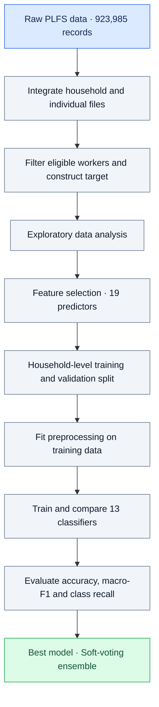
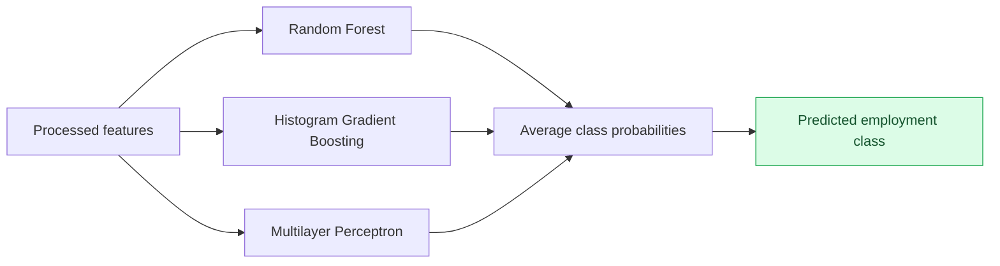

# Employment Classification in India | Machine Learning

**A multiclass classification study using the Periodic Labour Force Survey (PLFS), 2020–21**

Data Mining and Knowledge Discovery · DMS672 · IIT Kanpur

[Analysis Notebook](employment_classification.ipynb) · [Project Report](project_report.pdf) · [Dataset](data/)

---

## 1. Project Overview

India's workforce includes self-employed individuals, regular salaried employees, and casual labourers. This project applies machine learning to classify these employment arrangements using demographic, occupational, socioeconomic and household-level survey information.

The objective is to identify the factors associated with employment type, compare classification algorithms, and develop a robust model that performs well across all three classes, including the underrepresented casual-labour class.

| Raw survey records | Modelling records | Predictors | Models evaluated |
| :---: | :---: | :---: | :---: |
| **923,985** | **313,759** | **19** | **13** |

| Best model | Validation accuracy | Macro-F1 |
| :---: | :---: | :---: |
| **Soft-voting ensemble** | **86.12%** | **85.64%** |

## 2. Dataset

**Source:** Periodic Labour Force Survey (PLFS), India, July 2020 – June 2021.

The analysis integrates household and individual survey files from first visits and revisits. Employed respondents aged 15 and above are selected, and their Current Weekly Status (CWS) is mapped into three target categories.

| Target class | Observations | Distribution |
| :--- | ---: | ---: |
| Self-employed | 149,584 | 47.7% |
| Regular salaried | 119,019 | 37.9% |
| Casual labour | 45,156 | 14.4% |
| **Total** | **313,759** | **100.0%** |

Counts represent survey observations across visits, not necessarily unique individuals.

## 3. End-to-End Methodology



## 4. Exploratory Data Analysis

The analysis examines the relationship between employment type and worker characteristics, including occupation, industry, education, working hours, location and household expenditure.

| Finding | Interpretation |
| :--- | :--- |
| 81.0% of agricultural workers were self-employed | Employment arrangements vary substantially across industries. |
| 73.0% of construction workers were casual labourers | Industry provides useful information for classification. |
| Industry and occupation showed the strongest associations | Occupational features are important predictors. |
| Casual labour represents only 14.4% of observations | Accuracy alone is insufficient for evaluating model quality. |

These findings describe the unweighted survey sample and do not establish causal relationships.

## 5. Data Preprocessing & Feature Engineering

- Integrate first-visit and revisit household and person records.
- Filter the eligible working population and construct the three-class target.
- Select 19 predictors covering occupational, demographic and household information.
- Prepare numerical and categorical features for machine learning.
- Exclude earnings, target-defining information and other leakage-prone fields from model inputs.
- Keep all records from a household on the same side of the training/validation split.

The household-level split is particularly important because more than 43,000 households appear in both first-visit and revisit data. It reduces the risk of evaluating a model on households it has already seen during training.

## 6. Machine Learning Models

A total of 13 classifiers were evaluated, covering linear, tree-based, neural network and ensemble approaches.

Selected models include Logistic Regression, Pruned Decision Tree, Random Forest, Histogram Gradient Boosting, Multilayer Perceptron and Soft-Voting Ensemble.

### Ensemble architecture



Soft voting combines the predicted class probabilities of the three component models and selects the class with the highest average probability.

## 7. Model Evaluation & Results

Models are compared on **63,611 held-out validation observations** using accuracy, macro-F1 and class-wise recall. Macro-F1 is the primary comparison metric because it assigns equal importance to all three employment classes.

| Model | Accuracy | Macro-F1 | Casual-labour recall |
| :--- | ---: | ---: | ---: |
| Logistic Regression | 80.01% | 79.27% | 85.20% |
| Pruned Decision Tree | 82.23% | 81.71% | 84.48% |
| Random Forest | 83.69% | 83.13% | 85.61% |
| Histogram Gradient Boosting | 85.51% | 84.87% | **87.62%** |
| Multilayer Perceptron | 85.35% | 84.92% | 80.44% |
| **Soft-Voting Ensemble** | **86.12%** | **85.64%** | 85.04% |

### Key conclusions

- **Best overall classifier:** Soft-Voting Ensemble, achieving 86.12% accuracy and 85.64% macro-F1.
- **Best casual-labour recall:** Histogram Gradient Boosting, achieving 87.62%.
- **Main classification challenge:** Distinguishing self-employed and regular salaried workers. The ensemble misclassified 3,237 self-employed observations as regular salaried and 2,690 regular salaried observations as self-employed.

For the full model comparison, confusion matrix and detailed methodology, see the [project report](project_report.pdf).

## 8. Technology Stack

| Area | Tools |
| :--- | :--- |
| Programming | Python |
| Data manipulation | Pandas, NumPy |
| Data visualization | Matplotlib, Seaborn |
| Statistical analysis | SciPy |
| Machine learning | Scikit-learn |
| Development | Jupyter Notebook |

## 9. Repository Structure

```text
DATA_MINING_PROJECT/
├── README.md
├── employment_classification.ipynb
├── project_report.pdf
└── data/
    └── plfs.zip.part-*    # Seven parts of the survey archive
```

## 10. How to Run

Clone the repository:

```bash
git clone https://github.com/Shilpeekumari23/DATA_MINING_PROJECT.git
cd DATA_MINING_PROJECT
```

Install the required libraries:

```bash
python -m pip install jupyterlab numpy pandas matplotlib seaborn scipy scikit-learn
```

Reassemble and extract the dataset on macOS/Linux:

```bash
cat data/plfs.zip.part-* > plfs.zip
unzip plfs.zip
```

<details>
<summary>Windows dataset extraction</summary>

```shell
python -c "from pathlib import Path; import io, zipfile; parts = sorted(Path('data').glob('plfs.zip.part-*')); zipfile.ZipFile(io.BytesIO(b''.join(p.read_bytes() for p in parts))).extractall('.')"
```

</details>

Open the notebook:

```bash
jupyter lab employment_classification.ipynb
```

Set the dataset directory in the notebook setup cell:

```python
DATA_DIR = "CSV_Unit_level_data_PLFS_July2020_June2021"
```

Run the cells in sequence to reproduce the analysis and generate `plfs_validation_predictions.csv`.

## 11. Limitations & Future Scope

- The model classifies existing employment arrangements using information about the current job; it does not forecast future employment.
- The reported results are based on the unweighted PLFS 2020–21 sample.
- Generalization to other survey years and nationally weighted evaluation remain to be investigated.
