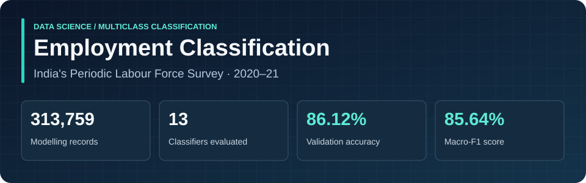
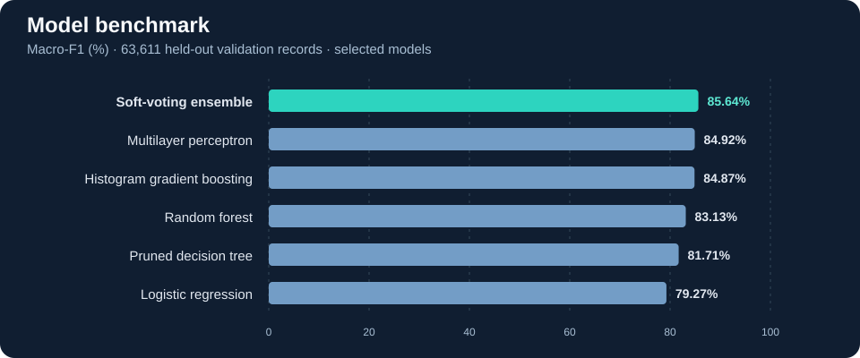
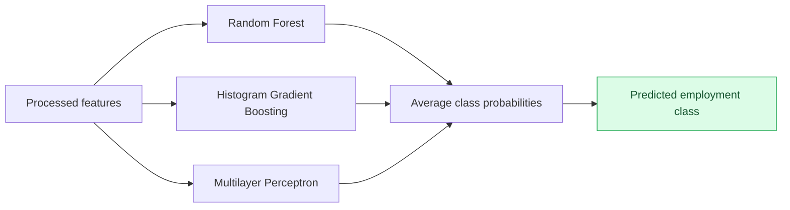
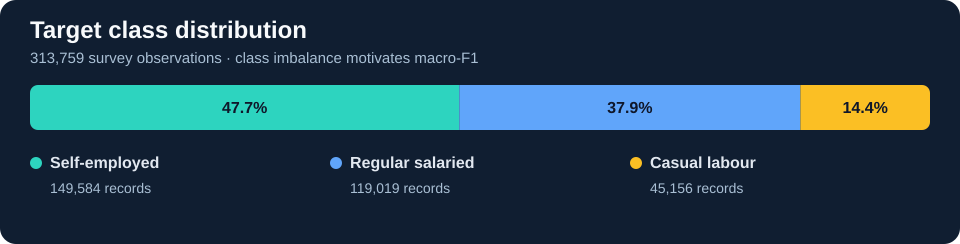

<div align="center">




**DMS672 · Data Mining and Knowledge Discovery · IIT Kanpur**

[Explore notebook](employment_classification.ipynb) · [Read report](project_report.pdf) · [Access dataset](data/) · [Quick start](#quick-start)

[Overview](#project-overview) · [Results](#model-performance) · [Workflow](#methodology) · [Dataset](#dataset--insights)

</div>

---

## Project overview

**Can machine learning distinguish self-employed, salaried and casual workers using occupational and socioeconomic survey data?**

This project transforms India's Periodic Labour Force Survey (PLFS), July 2020–June 2021, into a multiclass classification problem. It integrates **923,985 raw person records**, selects **19 predictors**, and benchmarks **13 classifiers** on unseen households.

| Technical challenge | Approach |
| :--- | :--- |
| Repeated household observations | Household-level validation split |
| Target leakage | Exclusion of earnings and target-defining information |
| Imbalanced employment classes | Macro-F1 and class-wise recall for model comparison |
| Model selection | Comparison of individual classifiers and probability-based ensemble |

## Model performance



The **soft-voting ensemble** achieved the best overall result, improving macro-F1 by **6.37 percentage points** over logistic regression. Histogram gradient boosting achieved the highest casual-labour recall at **87.62%**.

<details>
<summary><b>Expand detailed model comparison and error analysis</b></summary>

| Model | Accuracy | Macro-F1 | Casual-labour recall |
| :--- | ---: | ---: | ---: |
| Logistic Regression | 80.01% | 79.27% | 85.20% |
| Pruned Decision Tree | 82.23% | 81.71% | 84.48% |
| Random Forest | 83.69% | 83.13% | 85.61% |
| Histogram Gradient Boosting | 85.51% | 84.87% | **87.62%** |
| Multilayer Perceptron | 85.35% | 84.92% | 80.44% |
| **Soft-Voting Ensemble** | **86.12%** | **85.64%** | 85.04% |

### Key conclusions

- **Best overall classifier:** Soft-Voting Ensemble, achieving 86.12% accuracy and 85.64% macro-F1.
- **Best casual-labour recall:** Histogram Gradient Boosting, achieving 87.62%.
- **Main classification challenge:** Distinguishing self-employed and regular salaried workers. The ensemble misclassified 3,237 self-employed observations as regular salaried and 2,690 regular salaried observations as self-employed.

For the full model comparison, confusion matrix and detailed methodology, see the [project report](project_report.pdf).

</details>

## Methodology


### Data preprocessing & feature engineering

- Integrate first-visit and revisit household and person records.
- Filter the eligible working population and construct the three-class target.
- Select 19 predictors covering occupational, demographic and household information.
- Prepare numerical and categorical features for machine learning.
- Exclude earnings, target-defining information and other leakage-prone fields from model inputs.
- Keep all records from a household on the same side of the training/validation split.

The household-level split is particularly important because more than 43,000 households appear in both first-visit and revisit data. It reduces the risk of evaluating a model on households it has already seen during training.

### Ensemble architecture



Soft voting combines the predicted class probabilities of the three component models and selects the class with the highest average probability.

## Dataset & insights



**Source:** Periodic Labour Force Survey (PLFS), India, July 2020–June 2021.

The analysis integrates household and individual survey files from first visits and revisits, retaining employed respondents aged 15 and above. Current Weekly Status defines the three target classes. Counts represent observations across visits, not necessarily unique individuals.

### What the data reveals

| Key finding | Interpretation |
| :--- | :--- |
| **81.0%** of agricultural workers were self-employed | Employment arrangements vary across industries. |
| **73.0%** of construction workers were casual labourers | Industry provides useful classification information. |
| Industry and occupation had the strongest associations | Occupational features are important predictors. |
| Only **14.4%** of observations were casual labour | Accuracy alone is insufficient. |

These findings describe the unweighted sample and do not establish causality.

<details>
<summary><b>Expand exact class counts</b></summary>

| Target class | Observations | Distribution |
| :--- | ---: | ---: |
| Self-employed | 149,584 | 47.7% |
| Regular salaried | 119,019 | 37.9% |
| Casual labour | 45,156 | 14.4% |
| **Total** | **313,759** | **100.0%** |

</details>

## Technology stack

| Area | Tools |
| :--- | :--- |
| Programming | Python |
| Data manipulation | Pandas, NumPy |
| Data visualization | Matplotlib, Seaborn |
| Statistical analysis | SciPy |
| Machine learning | Scikit-learn |
| Development | Jupyter Notebook |

## Repository structure

```text
DATA_MINING_PROJECT/
├── README.md
├── employment_classification.ipynb
├── project_report.pdf
├── assets/                  # Project visuals (SVG)
└── data/
    └── plfs.zip.part-*    # Seven parts of the survey archive
```

## Quick start

Clone the repository:

```bash
git clone https://github.com/Shilpeekumari23/DATA_MINING_PROJECT.git
cd DATA_MINING_PROJECT
```

Install the required libraries:

```bash
python -m pip install jupyterlab numpy pandas matplotlib seaborn scipy scikit-learn
```

Reassemble and extract the dataset on macOS/Linux:

```bash
cat data/plfs.zip.part-* > plfs.zip
unzip plfs.zip
```

<details>
<summary>Windows dataset extraction</summary>

```shell
python -c "from pathlib import Path; import io, zipfile; parts = sorted(Path('data').glob('plfs.zip.part-*')); zipfile.ZipFile(io.BytesIO(b''.join(p.read_bytes() for p in parts))).extractall('.')"
```

</details>

Open the notebook:

```bash
jupyter lab employment_classification.ipynb
```

Set the dataset directory in the notebook setup cell:

```python
DATA_DIR = "CSV_Unit_level_data_PLFS_July2020_June2021"
```

Run the cells in sequence to reproduce the analysis and generate `plfs_validation_predictions.csv`.

## Limitations & future scope

- The model classifies existing employment arrangements using information about the current job; it does not forecast future employment.
- The reported results are based on the unweighted PLFS 2020–21 sample.
- Generalization to other survey years and nationally weighted evaluation remain to be investigated.

---

<div align="center">

[Notebook](employment_classification.ipynb) · [Technical report](project_report.pdf) · [Back to overview](#project-overview)

</div>
